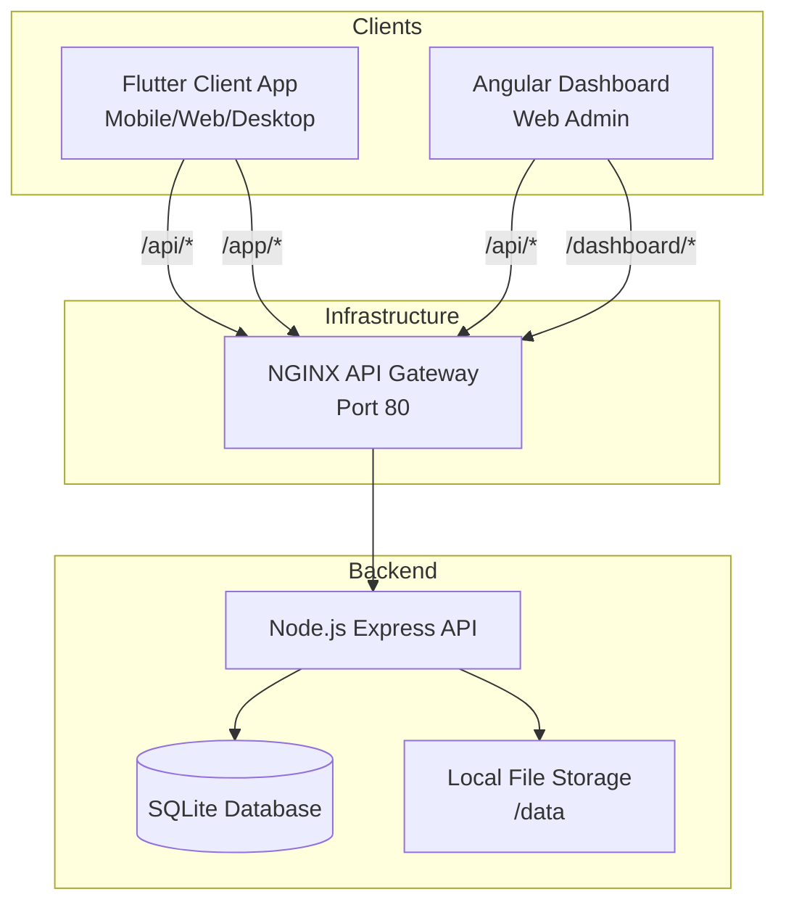

# Vibes

A modern, private media ecosystem featuring a TikTok-style vertical scrolling video player app, an Angular web dashboard, and a Node.js backend.

## System Architecture

The ecosystem consists of independent components that communicate seamlessly through an API Gateway:



- **API Gateway**: NGINX acts as a reverse proxy, routing requests based on paths (`/api`, `/app`, `/dashboard`).
- **Backend API**: The Node.js server handles authentication, media streaming, and metadata.
- **Clients**: Both the Flutter application and Angular dashboard interact directly with the API Gateway.

## Supported Platforms

The Flutter application (`app/`) is cross-platform and supports the following environments:
- **Mobile**: Android, iOS
- **Web**: Chrome, Safari, Firefox, Edge
- **Desktop**: macOS, Windows, Linux

## Project Structure

This repository is organized into four main components:

- **`app/`**: A Flutter application designed for a modern video viewing experience with vertical scrolling, likes, and notes.
- **`dashboard/`**: An Angular-based web administration dashboard for content management and uploads.
- **`server/`**: A robust Node.js Express API using `better-sqlite3` and JWT authentication to securely serve private media and handle metadata.
- **`infra/`**: Docker and Docker Compose configuration files containing an API Gateway and deployment configurations.

## Getting Started

### Prerequisites

To run this project locally without Docker, ensure you have the following installed:
- [Node.js](https://nodejs.org/) & npm
- [Flutter SDK](https://flutter.dev/docs/get-started/install)
- [Docker & Docker Compose](https://www.docker.com/) (for containerized deployment)

---

### Running via Docker (Recommended)

The easiest way to get the backend and dashboard running is using the provided Docker Compose configuration.

1. Navigate to the `infra` directory:
   ```bash
   cd infra
   ```
2. Build and start the containers:
   ```bash
   docker compose up -d --build
   ```

The Compose project (stack) is named `vibes`, with containers named `vibes-server-1` and `vibes-dashboard-1`.

**Services started:**
- **Server API**: Available at `http://localhost:3000`
- **Dashboard**: Available at `http://localhost:80` (or your mapped port)
- *Note: Application data (like sqlite database and media files) is persisted in a local Docker volume (`vibes_data`).*

---

### Local Development Setup
If you wish to run the components independently for development, check the README inside each respective folder:
- [Backend Server (Node.js)](server/README.md)
- [Admin Dashboard (Angular)](dashboard/README.md)
- [Video Feed App (Flutter)](app/README.md)

### Deployment (Docker)
The easiest way to get the entire ecosystem running seamlessly is using the provided Docker Compose configuration in the `infra` folder. This uses an NGINX API Gateway to serve everything on a single port (Port 80).

Read the [Infra Deployment Guide](infra/README.md) for full instructions on how to deploy this stack from scratch.
